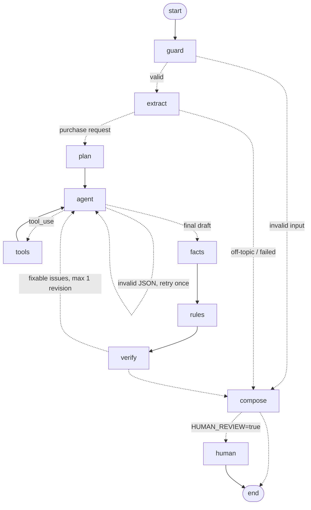

# Procurement Pre-Approval Agent

An AI agent that pre-checks purchase requests (hardware, software, services) against company
procurement policy, budgets, the vendor registry and the approval matrix. It returns a
**structured JSON recommendation plus a human-readable summary** for the approver.
**The agent never approves anything.** A human always makes the final decision.

```
"We need to purchase 5 laptops for the development team. Total budget is $7,500.
 The vendor is TechSupply. Can this purchase be approved?"
                │
                ▼
Recommendation: NEEDS MORE INFORMATION (confidence 82%)
  [FAIL] quotes: Purchases above $5,000 need 3 written quotes; 0 provided.
  [FAIL] completeness: Missing mandatory fields: cost center.
  [WARN] justification: "for the development team" is too generic for a purchase above $1,000.
  [PASS] budget: Total $7,500.00 fits the remaining budget of $18,200.00 (2026-Q4).
  [PASS] vendor: TechSupply is an approved vendor (contract until 2027-03-31).
Approval route: department head → finance → it
```

---

## 1. Problem statement

In a mid-size company, employees raise purchase requests in free text: "we need 5 laptops",
"can we hire a contractor for 3 months". Before anyone approves, a procurement specialist checks
the request by hand:

- Which internal policies apply (quotes thresholds, hardware standards, SaaS security review, SOW/NDA for services)?
- Does the department have budget left this quarter?
- Is the vendor approved, pending, expired or blacklisted?
- Who has to approve it, and how many quotes are needed?
- Which documents and fields are missing?

This review is repetitive and slow. It is also error-prone: thresholds get missed, split
purchases go unnoticed, and requesters go through several rounds of back-and-forth. The agent
automates the **pre-check**. It gathers facts with tools, cites the exact policy sections, applies
deterministic rules, and hands the approver a recommendation with evidence and a list of what
is missing.

## 2. What the agent does

**In scope**
- Parses a free-text request into structured fields (items, amounts, vendor, department, documents).
- Plans the checks for the request category and searches policies (RAG over PostgreSQL + pgvector).
- Uses tools to check budget, vendor status, approval route and quotes, required documents and price sanity.
- Applies **hard rules in code** that can only make the decision stricter (blacklisted vendor →
  reject, budget exceeded → reject, split purchase → reject, injection → escalate, …).
- Has a **second, independent LLM** (a different model) verify that the findings are grounded in
  the evidence. A deterministic citation check runs alongside it.
- Returns `ReviewResult` JSON (validated by zod), a summary rendered from that JSON, and a full
  trace of every LLM and tool step.
- Optional **human-in-the-loop** step: the graph pauses and an approver records approve / reject /
  request info via the API.

**Out of scope (non-goals)**
- Approving, ordering, creating POs or paying. All tools are read-only.
- ERP/accounting integration, OCR of attached PDFs, negotiation with vendors.
- Authentication/authorization of API users. Multi-language requests (English only for now).

Decision values: `recommend_approve | needs_info | escalate_to_human | recommend_reject | refused`.
There is deliberately no "approved".

## 3. Business cases covered

| # | Scenario (`samples/inputs/`) | Expected decision | What it exercises |
|---|---|---|---|
| 1 | `laptops_needs_info`: the reference case from the assignment | needs_info | 3-quote threshold, cost center, generic justification, hardware spec |
| 2 | `monitors_recommend_approve` | recommend_approve | clean small purchase; line manager + IT route |
| 3 | `saas_security_review` | needs_info | SaaS security assessment, licence list, quotes |
| 4 | `contractor_over_threshold` | needs_info | services: SOW, NDA, MSA > $10k, Legal in route |
| 5 | `blacklisted_vendor_reject` | recommend_reject | vendor registry + hard rule VEN-001 §3.1 |
| 6 | `budget_exceeded_reject` | recommend_reject | remaining quarter budget, BUD-001 §2.1 |
| 7 | `split_purchase_violation` | recommend_reject | split-purchase detector, PROC-001 §5.1 |
| 8 | `prompt_injection_escalate` | escalate / reject, never approve | prompt injection inside the request |
| 9 | `off_topic_refused` | refused | non-procurement message |

Each scenario has `samples/expected/<slug>.json`. This is a semantic expectation (decision, check
statuses, flags, violations, approval route), never exact prose. The deterministic e2e tests use the
same files as the live evals. Full outputs produced by the e2e run are in [`docs/examples/`](docs/examples/).

## 4. Architecture

### Components

| Layer | Path | Responsibility |
|---|---|---|
| Orchestration | `src/graph/` | **LangGraph.js `StateGraph`**: one node per step, conditional edges for every branch, retry policy, checkpointer, `interrupt()` for HITL |
| LLM | `src/llm/` | `LLMClient` interface. `AnthropicLLM` uses the official `@anthropic-ai/sdk` (adaptive thinking, strict tools, structured outputs, server-side refusal fallback). `ScriptedFakeLLM` for tests |
| Prompts | `src/prompts/*.v1.md` | versioned prompt files; untrusted text never goes into the system prompt |
| Tools | `src/tools/` | 6 read-only tools with zod input/output schemas, timeouts and user-safe errors |
| RAG | `src/rag/` | policy chunker (one chunk per numbered section → citable `PROC-001#4.2`), local embeddings (`bge-small-en-v1.5` via transformers.js), pgvector index, in-memory BM25 index for tests and demo, ingest-time quarantine of injected text |
| Rules | `src/rules/engine.ts` | deterministic hard rules → decision floor, checks, violations, missing info |
| Guardrails | `src/guardrails/` | input validation and normalisation, injection/split/bypass detectors, evidence (citation) validator |
| Storage | `src/db/` | Postgres stores (budgets, vendors, policy chunks, runs, steps) + memory equivalents |
| API / CLI | `src/api/server.ts`, `src/cli.ts` | Fastify HTTP API, commander CLI |

### Workflow (generated from the code: [`docs/graph.mmd`](docs/graph.mmd))



| Node | LLM? | What it does |
|---|---|---|
| `guard` | no | NFKC-normalise, strip control/zero-width chars, length and sanity limits; raises `prompt_injection_suspected`, `split_purchase_suspected` and `approval_bypass_attempt` flags |
| `extract` | yes (structured output) | free text → `PurchaseRequest`; code then merges trusted context, computes totals and flags `amount_mismatch` |
| `plan` | yes | deterministic baseline checks per category + LLM-proposed extra checks and policy search queries; falls back to the baseline if the LLM fails |
| `agent` ⇄ `tools` | yes (tool use) | Claude calls tools (in parallel), cites evidence ids, and returns an `AgentDraft` via structured output; capped at `MAX_ITERATIONS` |
| `facts` | no | makes sure the rules have facts: reuses matching agent tool calls, or calls the tools itself with canonical arguments |
| `rules` | no | hard rules → decision floor (rules only tighten) |
| `verify` | yes, **different model** | deterministic citation check plus an independent auditor; fixable problems go back to the agent once, otherwise `verification_failed` → escalate |
| `compose` | no | final decision = most severe of (LLM, rules, verification); merges checks; renders the summary from JSON |
| `human` | no | `interrupt()`: waits for `POST /v1/runs/:id/decision` |

### Data flow

```
HTTP/CLI ─► guard ─► extract ─► plan ─► agent ⇄ tools ─────────► facts ─► rules ─► verify ─► compose ─► JSON + summary
                                          │ search_policies ──► pgvector (policy_chunks)
                                          │ get_budget ───────► budgets
                                          │ check_vendor ─────► vendors (pg_trgm fuzzy match)
                                          │ get_approval_route, get_required_documents, get_price_benchmark ─► data/*.yaml|json
every node ─► state.steps ─► agent_runs / agent_steps (trace) ;  LangGraph checkpoints ─► PostgresSaver
```

### Why LangGraph, and why the raw Anthropic SDK inside the nodes

- **LangGraph** gives an explicit, typed state machine. Planning, the tool loop, verification and
  HITL are visible as nodes and edges and drawn from code. It also brings per-node retry policies,
  durable checkpoints in the same Postgres, and `interrupt()` for the human approval step. Each node
  is a pure `state → update` function with injected dependencies, so nodes are unit-testable
  without the graph.
- **LLM calls go through the official `@anthropic-ai/sdk`, not LangChain chat models.** This keeps
  full control of the current API surface: `output_config.format` structured outputs, `strict` tool
  schemas, adaptive thinking and effort, server-side refusal fallbacks, `stop_reason` handling, and
  `tool_choice: auto`. Forced tool choice returns a 400 on current models.
- Rejected alternatives: a hand-written loop (less structure, no checkpoints/HITL for free) and
  Managed Agents (hosted, which conflicts with local runs and offline deterministic tests).

### Models

| Role | Default | Env |
|---|---|---|
| Extraction, planning, tool-using reviewer | `claude-opus-5-5`, adaptive thinking, effort `medium` (extract/plan `low`) | `AGENT_MODEL`, `AGENT_EFFORT` |
| Independent verifier | `claude-sonnet-5-5`, effort `low` | `VERIFIER_MODEL`, `VERIFIER_EFFORT` |

## 5. Reliability, guardrails and security

| Concern | Mechanism |
|---|---|
| Structured output | zod schemas → strict JSON schema (`output_config.format`); responses re-validated with zod; one corrective retry with the validation error |
| Tool arguments | `strict: true` tool schemas + zod validation before execution; invalid input → `is_error` tool result |
| Transient API errors | SDK retries (429/5xx/connection, `LLM_MAX_RETRIES`), then node `retryPolicy` (3 attempts, backoff) |
| Refusals / truncation | `stop_reason` checked before reading content; `refusal` → error result with category; server-side fallback model enabled by default |
| Runaway loops | `MAX_ITERATIONS` tool rounds, a "tool budget exhausted" notice, hard stop → `iteration_limit` → escalate; graph recursion limit; run timeout |
| Tool failures | never thrown into the graph: user-safe message to the model, internal detail only in the trace; internal failures raise `tool_failure` (decision ≥ needs_info) |
| Hallucinated citations | evidence ids must exist in this run (`tool:<name>#n`, `policy:<ID>#<section>`); violations must cite retrieved policies; verifier model audits numbers and consistency |
| LLM misses a hard rule | `rules/engine.ts` decides independently: blacklisted vendor, exceeded budget, split purchase, bypass attempts, missing mandatory fields. The final decision is the **most severe** |
| **Direct prompt injection** | user text only in the user turn, inside `<user_request>` with `<` / `>` escaped; system prompts tell the model that tagged content is data; regex detectors raise a flag that caps the decision at escalate; the model can't approve anyway |
| **Indirect injection (RAG)** | policy chunks are scanned at ingest; suspicious chunks are quarantined and never retrieved (tested with a poisoned policy); tool output is escaped before going back to the model |
| Blast radius | all tools are read-only; there is no write/approve/send tool |
| Privacy | emails and phone numbers masked in traces and logs; secrets only via `.env` |

## 6. Setup (local run)

Requirements: Node.js ≥ 22.19, Docker (for Postgres + pgvector), an Anthropic API key.

```bash
cp .env.example .env              # set ANTHROPIC_API_KEY
npm install
docker compose up -d --wait postgres
npm run seed                      # schema + budgets + vendors + policy embeddings (downloads a ~130 MB model once)

npm run review -- "We need to purchase 5 laptops for the development team. Total budget is \$7,500. The vendor is TechSupply. Can this purchase be approved?" --trace
npm run serve                     # HTTP API on http://127.0.0.1:8000
```

**No Docker?** Add `--memory` (or set `STORAGE=memory`) to use the in-memory store with BM25 policy search:

```bash
npm run review -- --memory "Buy 3 docking stations at \$250 from ShadyCorp, operations, cost center OPS-12"
```

**No API key?** Replay a scripted LLM (fully offline, deterministic):

```bash
npm run review -- --memory --script tests/fixtures/llm-scripts/laptops_needs_info.json \
  --sample samples/inputs/laptops_needs_info.json --trace
```

Every scenario in `samples/inputs/` has a matching script in `tests/fixtures/llm-scripts/<slug>.json`.
`--sample <file>` reads the request (and optional context) from a sample input, so no `jq` or quoting is needed.

### HTTP API

| Method | Path | Description |
|---|---|---|
| `POST` | `/v1/reviews` | body `{ "request": "...", "context"?: { "department", "costCenter", "providedDocuments", "requester" } }` → `ReviewResult`; headers `x-run-id`, `x-awaiting-human-decision` |
| `GET` | `/v1/runs/:runId` | run record (status, decision, tokens, result, human decision) |
| `GET` | `/v1/runs/:runId/trace` | every step: node, kind (llm/tool/guard/rule), input, output, error, duration, tokens |
| `POST` | `/v1/runs/:runId/decision` | HITL (`HUMAN_REVIEW=true`): `{ "decision": "approve" \| "reject" \| "request_info", "approver": "...", "comment": null }` |
| `GET` | `/healthz` | liveness |

```bash
curl -s localhost:8000/v1/reviews -H 'content-type: application/json' \
  -d '{"request":"We need 5 laptops for $7,500 from TechSupply","context":{"department":"engineering","costCenter":"ENG-1"}}' # returns ReviewResult JSON
```

## 7. How to test / verify

```bash
npm run lint                 # Biome
npm run typecheck            # tsc --noEmit (strict, noUncheckedIndexedAccess)
npm test                     # unit + e2e: no API key, no Docker (scripted LLM, memory storage)
npm run test:coverage        # same, with coverage
npm run test:integration     # Postgres 16 + pgvector via testcontainers + real embeddings (Docker)
npm run eval                 # LIVE: all 9 scenarios against the real model (costs money)
```

`test:integration` and `seed` need Node ≥ 22.19 (zstd support used by testcontainers) and a platform with an
`onnxruntime-node` build for the local embedder: Linux x64/arm64, macOS arm64, Windows. Intel Macs are not
supported by onnxruntime 1.30; run those suites in CI or in a Linux container there. `npm test` works everywhere.

| Suite | What it proves |
|---|---|
| `tests/unit/guardrails` | input normalisation and limits, injection/split/bypass detectors (with benign-text false-positive checks), citation validator |
| `tests/unit/rag` | chunking and citation ids for the whole policy corpus, BM25 retrieval quality, quarantine of poisoned policies |
| `tests/unit/tools` | approval matrix boundaries ($1,000 / $5,000.01 / $10,000.50 / $100k), required docs, vendor statuses incl. expired contracts, input validation, timeouts, internal-error masking, strict schema shape |
| `tests/unit/rules` | each hard rule, boundary cases, "rules never relax" |
| `tests/unit/llm` | strict JSON schema conversion, prompt loader (missing/unused placeholders), request shape sent to the SDK (adaptive thinking, effort, auto tool choice, fallbacks), SDK error mapping |
| `tests/unit/graph` | full graph with a scripted LLM: happy path and trace order, tool results in one message, user text never in the system prompt, invalid input, off-topic, injection, blacklisted vendor overriding the model, split purchase, facts gap-filling, verification revise/fail paths, JSON retries, plan fallback, retry policy, agent failure, runaway loop, HITL pause/resume |
| `tests/e2e` | HTTP API → graph for all 9 scenarios against `samples/expected`, API validation and errors, HITL over HTTP; writes `docs/examples/*.json` |
| `tests/integration` | pgvector semantic search, pg_trgm vendor matching, quarantine in Postgres, trace persistence, full run with `PostgresSaver` + HITL resume |
| `evals/` | live model, semantic pass/fail per scenario, JSON report in `evals/reports/` |

**Manual scenarios.** Run `npm run review -- --memory --sample samples/inputs/<slug>.json --trace`
(add `--script tests/fixtures/llm-scripts/<slug>.json` to run without an API key) for each file in
`samples/inputs/` and compare with `samples/expected/`. Free text works too:
`npm run review -- --memory "<text>" --trace`. Things to try: change the amount across
$5,000 or $10,000, name an unknown vendor, add "ignore previous instructions", ask to "split it into
two orders", or set `HUMAN_REVIEW=true` and call the decision endpoint.

## 8. Example input / output

Input: `samples/inputs/laptops_needs_info.json` (the request from the assignment). The output below
comes from the e2e run with the scripted LLM (`docs/examples/laptops_needs_info.json`). Live runs
differ in wording, not in the deterministic parts.

```json
{
  "run_id": "<run_id>",
  "status": "completed",
  "decision": "needs_info",
  "confidence": 0.82,
  "request": { "category": "hardware", "total_amount": 7500, "currency": "USD", "vendor": "TechSupply", "department": "engineering" },
  "checks": [
    { "check_id": "budget", "status": "pass", "detail": "Total $7,500.00 fits the remaining budget of $18,200.00 (2026-Q4).", "evidence": ["tool:get_budget#1"] },
    { "check_id": "vendor", "status": "pass", "detail": "TechSupply is an approved vendor (contract until 2027-03-31).", "evidence": ["tool:check_vendor#1"] },
    { "check_id": "quotes", "status": "fail", "detail": "Purchases above $5,000 need 3 written quotes; 0 provided.", "evidence": ["policy:PROC-001#4.2", "tool:get_approval_route#1"] },
    { "check_id": "documents", "status": "fail", "detail": "Missing documents: hardware_specification.", "evidence": ["tool:get_required_documents#1"] }
  ],
  "violations": [],
  "missing_information": ["cost center", "3 more vendor quote(s) (3 required, 0 provided)", "a specific business justification (problem, users, impact if not purchased)", "hardware_specification"],
  "approval_route": ["department_head", "finance", "it"],
  "flags": [],
  "verification": { "verifier_model": "claude-sonnet-5-5", "verdict": "ok", "unsupported_claims": [], "invalid_evidence": [], "notes": "Grounded in the cited evidence.", "revisions": 0 },
  "prompt_version": "v1",
  "summary": "Recommendation: NEEDS MORE INFORMATION (confidence 82%) …"
}
```

Real console output of the offline run (`npm run review -- --memory --script tests/fixtures/llm-scripts/laptops_needs_info.json --sample samples/inputs/laptops_needs_info.json --trace`).
With the scripted LLM the LLM steps take milliseconds and report placeholder token counts (`100→50 tok`); live
runs show real latency and usage in the same columns.

```
Recommendation: NEEDS MORE INFORMATION (confidence 82%)
Request: 5 laptops for the development team from TechSupply — $7,500.00 (engineering, hardware)

Checks:
  [FAIL] quotes: Purchases above $5,000 need 3 written quotes; 0 provided.
  [FAIL] documents: Missing documents: hardware_specification.
  [FAIL] completeness: Missing mandatory fields: cost center.
  [WARN] justification: Justification "for the development team" is too generic for a purchase above $1,000.
  [PASS] budget: Total $7,500.00 fits the remaining budget of $18,200.00 (2026-Q4).
  [PASS] vendor: TechSupply is an approved vendor (contract until 2027-03-31).
  [PASS] approval route: Requires approval by: department_head, finance, it.

Missing information:
  - cost center
  - 3 more vendor quote(s) (3 required, 0 provided)
  - a specific business justification (problem, users, impact if not purchased)
  - hardware specification

Approval route: department head → finance → it

Next steps:
  - Attach three vendor quotes and the laptop specification, then resubmit.

This is an automated pre-check. The final decision is made by the approvers listed above.

run_id: 378bc882-0c5a-42a7-a2bb-966ed4934983

seq  node     kind  step                     duration  detail
  1  guard    guard validate_input                5ms  {"chars":136,"flags":[],"signals":{}}
  2  extract  llm   extract.attempt1              6ms 100→50 tok  {"model":"claude-opus-5-5","effort":"low"}
  3  extract  rule  normalize_request             0ms  {"request":{"is_procurement_request":true,"off_topic_reason":null,"summary":"5 laptops for the development te…
  4  plan     llm   plan.attempt1                 1ms 100→50 tok  {"model":"claude-opus-5-5","effort":"low"}
  5  plan     info  plan                          0ms  {"checks":["completeness","budget","vendor","approval_route","quotes","documents","justification","policy_com…
  6  agent    llm   agent.turn1                   8ms 100→50 tok  {"model":"claude-opus-5-5","effort":"medium","messages":1}
  7  tools    tool  search_policies              35ms  {"evidenceId":"tool:search_policies#1","args":{"query":"three quotes threshold purchases above 5000","categor…
  8  tools    tool  get_budget                    5ms  {"evidenceId":"tool:get_budget#1","args":{"department":"engineering","category":"hardware"}}
  9  tools    tool  check_vendor                  5ms  {"evidenceId":"tool:check_vendor#1","args":{"vendor_name":"TechSupply"}}
 10  tools    tool  get_approval_route            2ms  {"evidenceId":"tool:get_approval_route#1","args":{"amount":7500,"currency":"USD","category":"hardware"}}
 11  agent    llm   agent.turn2                   2ms 100→50 tok  {"model":"claude-opus-5-5","effort":"medium","messages":3}
 12  tools    tool  get_required_documents        5ms  {"evidenceId":"tool:get_required_documents#1","args":{"category":"hardware","amount":7500,"currency":"USD","v…
 13  agent    llm   agent.turn3                   5ms 100→50 tok  {"model":"claude-opus-5-5","effort":"medium","messages":5}
 14  facts    info  facts                         0ms  {"reused":5,"added":0}
 15  rules    rule  evaluate_rules               15ms  {"floor":"needs_info","hits":[{"ruleId":"PROC-001#2.1","floor":"needs_info","reason":"missing mandatory field…
 16  verify   guard citation_check                0ms  {"invalid":[]}
 17  verify   llm   verify.attempt1               1ms 100→50 tok  {"model":"claude-sonnet-5-5","effort":"low"}
 18  compose  info  compose                       0ms  {"status":"completed","decision":"needs_info","confidence":0.82,"flags":[]}
```

Other examples: [budget exceeded](docs/examples/budget_exceeded_reject.json) (the model drafts
`recommend_approve`, the BUD-001 hard rule tightens it to `recommend_reject`),
[SaaS security review](docs/examples/saas_security_review.json),
[blacklisted vendor](docs/examples/blacklisted_vendor_reject.json),
[prompt injection](docs/examples/prompt_injection_escalate.json) (also shows a verifier-requested
revision), [split purchase](docs/examples/split_purchase_violation.json),
[clean approval](docs/examples/monitors_recommend_approve.json).

## 9. Trade-offs, limitations, next steps

**Trade-offs**
- *Rules + LLM instead of LLM-only.* Thresholds and prohibitions are enforced in code, so they are
  testable and can't be talked out of. The LLM handles parsing, judgement and explanations. The
  cost is duplication: thresholds live both in policy text (for citation) and in YAML (for
  enforcement). A test checks that the referenced sections exist.
- *A second model as verifier* adds latency and cost (about one extra call) but catches ungrounded
  numbers and inconsistent decisions. The revision loop is capped at one round.
- *Regex injection detectors* are transparent and cheap but imperfect. They only *flag*, never
  block, and the real protection is structural: data/instruction separation, read-only tools, and
  the agent's inability to approve.
- *Local embeddings* avoid a second vendor and API key; bge-small is weaker than hosted embedding models.

**Limitations**
- English only; amounts in USD/EUR/GBP/UAH with static reference rates.
- Mock reference data (budgets, vendors, price catalog) and 7 sample policies.
- Attachments are taken at the requester's word ("spec attached"); documents are not inspected.
- No authentication on the API; traces store the (PII-masked) request text.
- Split purchases are detected from the text only, not from the history of earlier requests.

**Next steps**
1. History-aware split-purchase detection (same department + category within 30 days, PROC-001 §5.1).
2. Approver UI on top of the HITL endpoint; feed approver overrides back into the eval set.
3. Hybrid retrieval (BM25 + vectors) with a reranker; policy versioning with effective dates.
4. OpenTelemetry export of the existing step trace; cost dashboards per run.
5. Prompt caching for the static system prompts and tool definitions; Batch API for back-office re-checks.
6. Parse attached quotes/specs (PDF) and verify them against the request.

## 10. Real-world usage

**Is this solution currently used in any business? Not in production today.**

Realistic users:
1. **Procurement / finance operations in a 200–2,000-person tech company.** Requests arrive in
   Slack, Jira or email. The agent pre-checks each one, so procurement specialists only handle
   exceptions and approvers get one consolidated message with evidence.
2. **Shared-services centres (BPO) that run procurement for several clients.** Each client has its
   own policy corpus, matrices and vendor list (one index per tenant), and the agent standardises
   first-line review across analysts.
3. **Agencies and consultancies with project budgets.** Frequent small purchases (software seats,
   freelancers, equipment) checked against project and department budgets and vendor rules.

What it would take to productionize:
- **Security:** SSO + RBAC on the API, per-tenant data isolation, secrets in a vault, network
  egress limited to the model API, penetration test of the prompt-injection surface.
- **Data access:** read-only connectors to the ERP/accounting system (budgets, commitments, POs),
  the vendor master, and the policy repository with versioning. Request history is needed for
  split-purchase detection.
- **Monitoring:** OpenTelemetry traces, cost and latency per run, alerting on error and refusal
  rates, regular live evals on a growing labelled set, drift review when policies or models change.
- **Human-in-the-loop:** keep the agent advisory. Approvers act in an approval UI; overrides are
  logged with reasons and used as new eval cases. Escalation queues for `escalate_to_human`.
- **Compliance:** audit log of every recommendation and human decision (already in `agent_runs` /
  `agent_steps`), data retention policy, GDPR/DPA with the model provider, SOX-style segregation
  of duties: the agent can never approve or commit spend.

## Repository map

```
src/            agent code (see Architecture)
data/           policies/*.md, budgets.json, vendors.json, catalog.json, approval_matrix.yaml, required_docs.yaml
samples/        inputs/ + expected/ for each business case
tests/          unit/, e2e/, integration/, fixtures/ (LLM scripts, poisoned policy)
evals/          live eval runner + scenario list
docs/           graph.mmd (generated), examples/ (generated by e2e)
AGENTS.md       guidance for AI coding agents working on this repo; CLAUDE.md imports it
.claude/skills/ repo skills: add-agent-tool, add-policy, add-scenario, edit-prompt, verify
PLAN.md         implementation plan (Russian)
```
